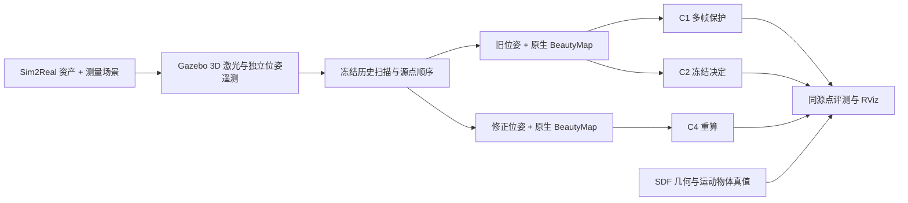
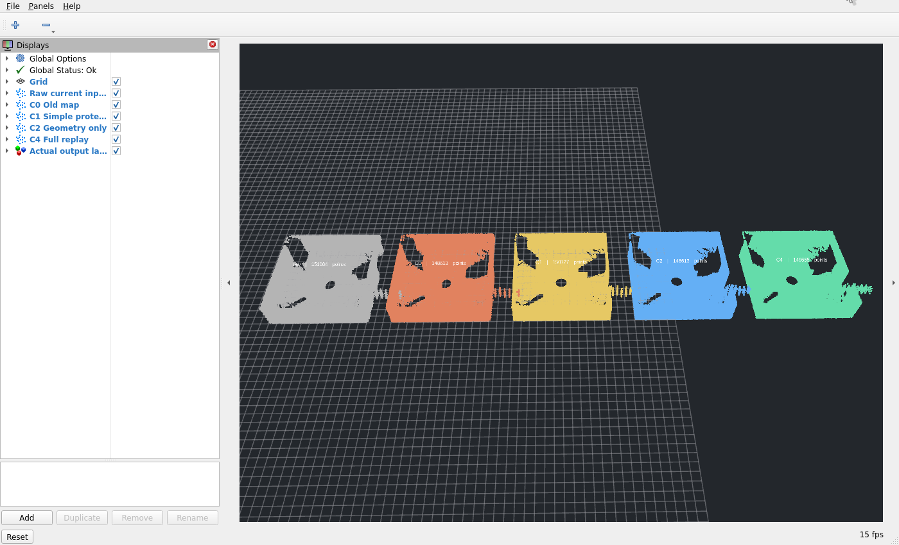

# SLAM-Physical

**位姿修正之后，地图只改坐标够不够？**

这是 [SLAM_Learning](https://github.com/p20030920p/SLAM_Learning) 的独立仿真实验与本机演示仓库。当前实现 BeautyMap 静态位姿修正、C1/C2/C4 对照，以及首个物体离场检查场景。所有演示重新执行算法，命令行显示真实进度，RViz 显示当前运行产生的点云。

**新增：Windows / WSL2 键盘驾驶、AMCL 实时偏移与录制。** [操作指南及论文接入办法](docs/WINDOWS_AMCL.zh-CN.md)。新实验使用有轮关节与碰撞的移动底盘，单独评测定位；下文原有传感器架实验保持自己的范围。

| 新入口 | 用途 |
|---|---|
| [10_amcl_keyboard.cmd](10_amcl_keyboard.cmd) | 移动仿真、AMCL、RViz、Windows 键盘终端及自动录制 |
| [11_build_localization_maps.cmd](11_build_localization_maps.cmd) | 从一次驾驶生成 raw、BeautyMap、DUFOMap、RGB-D raw、ConceptGraphs、HOV-SG 的定位地图 |
| [12_amcl_choose_map.cmd](12_amcl_choose_map.cmd) | 选择算法地图，键盘驾驶并观看实时偏移 |
| [13_compare_localization.cmd](13_compare_localization.cmd) | 选择另一次测试录制，相同输入逐图回放，输出误差、观测延迟与 CPU/RSS 对照 |
| [14_static_keyboard.cmd](14_static_keyboard.cmd) | 纯静态场景，使用实际录制生成的原始地图，键盘驾驶并自动录制 |
| [15_dynamic_keyboard.cmd](15_dynamic_keyboard.cmd) | 三个运动障碍物；菜单选择不使用论文算法或使用论文算法的地图，键盘驾驶并自动录制 |
| [16_record_static_dynamic.cmd](16_record_static_dynamic.cmd) | 自动录制静态/动态建图 A 与独立测试 B、运行原生方法、重复 AMCL 回放并生成报告和数据回放视频 |

先用 `10` 录制建图路线，用 `11` 生成轮速位姿版本地图；再用 `10` 或 `12` 录制独立测试路线，最后用 `13` 比较。`10` 默认地图来自明确标注的 SDF 参考几何。`11` 默认使用轮速位姿；`16` 默认在建图 A 中使用仿真提供的传感器位姿，隔离轮速漂移与动态过滤影响，测试 B 的 AMCL 不使用真值。两者均不会用 SDF 几何填补算法地图。CG/HOV 这里只检验几何投影的定位影响，AMCL 不消费语义特征。建图耗时与定位耗时分开记录。

`14` / `15` 优先使用本机最近完成的静态/动态录制地图。两种场景共用静态结构，动态场景额外加入沿固定轨迹运动的三个箱体。`16` 默认主对照重复三次，另用同一个动态测试 B 在干净静态地图上做一次控制实验；保存每组结果而非挑选最佳运行。详细流程见 [静态/动态定位指南](docs/WINDOWS_AMCL.zh-CN.md)。

[本次静态/动态定位实测](docs/results/static-dynamic/README.md)：四份原始录制、十二张传感器建图结果与 42 次有效 AMCL 回放。便携证据保存地图、指标、对比图和录制数据重绘视频；完整 bag、扫描与原生运行产物保留在本机 `runs/`。

## 静态与动态定位 GIF

[SLAM_Learning 首页四类 GIF 与效果表](https://github.com/p20030920p/SLAM_Learning/blob/main/docs/HOME.zh-CN.md#静态与动态定位录制)：纯静态、动态 LiDAR、动态 RGB-D 几何，以及干净地图＋相同动态测试。每类保留完整 MP4 与 GIF，画面由录制数据重绘，包含轨迹和实时误差曲线。[媒体时序与来源哈希](https://github.com/p20030920p/SLAM_Learning/blob/main/results/localization/static-dynamic/timing.json)。

同一动态测试 B，排除最初 5 秒后的平面定位 RMSE：原始 LiDAR **6.29 cm**，BeautyMap **5.52 cm**（降低 12.3%），DUFOMap **5.06 cm**（降低 19.5%）；RGB-D 家族原始 **6.45 cm**，ConceptGraphs **6.02 cm**，HOV-SG **6.28 cm**。纯静态场景中 BeautyMap、DUFOMap 略差于原始地图。建图 A 使用给定位姿，测试 B 不向 AMCL 提供真值；CG/HOV-SG 仅评测离线几何投影。

## 本机双击入口

在本机 `D:\workspace\be2\SLAM-Physical` 使用：

| 文件 | 行为 |
|---|---|
| [00_check.cmd](00_check.cmd) | 检查两个 WSL、ROS、RViz、四个原生算法环境和权重 |
| [00_setup.cmd](00_setup.cmd) | 安装专用 Ubuntu-24.04 / ROS Jazzy / Gazebo Harmonic，拉取锁定的仿真资产 |
| [01_reproduce.cmd](01_reproduce.cmd) | 菜单选择 BeautyMap、DUFOMap、ConceptGraphs 或 HOV-SG，重新执行原生流程并启动 RViz |
| [02_experiment.cmd](02_experiment.cmd) | 静态场景：Gazebo 实际采集 → 位姿扰动/修正 → 原生 BeautyMap → C1/C2/C4 → CSV、报告、地图 |
| [04_departure_experiment.cmd](04_departure_experiment.cmd) | 首个动态场景：箱体分步运动、穿过门口离开，检查静态恢复与动态残影的取舍 |
| [03_stop.cmd](03_stop.cmd) | 请求停止当前本仓库会话；采集和原生子进程退出，已写结果保留 |
| [90_update.cmd](90_update.cmd) | 干净 main 分支执行 fast-forward 更新；有本地修改时保留文件并停止更新 |

首次在**这台机器**使用，先运行检查；现有环境已完成安装与实跑验证。每次生成新的 `runs/<时间戳>/`，结束后命令窗口等待 Enter，便于检查 RViz。实验显示 raw、C0、C1、C2、C4 五列，显示时横向平移 15 m；保存的地图始终使用原世界坐标。

复现默认使用 8 个观测：BeautyMap / DUFOMap 使用已准备的 KITTI-00 扫描；ConceptGraphs / HOV-SG 使用缩放到 320×180 的 Replica room0 子集，并重新计算 SAM/CLIP。HOV-SG 当前入口运行特征建图，不包含楼层/房间层级和导航。小样本演示不替代论文的正式评测协议。

## 当前实现

| 组 | 历史分类决定 | 最终点坐标 |
|---|---|---|
| C0 诊断 | 旧位姿下 BeautyMap 的保留/删除结果 | 旧位姿 |
| C1 简单保护 | 旧结果 OR 旧坐标 20 cm 体素内至少 3 个不同帧的支持 | 修正位姿 |
| C2 仅几何修正 | 冻结旧保留/删除结果 | 修正位姿 |
| C4 完整重算 | 原生 BeautyMap 在相同历史输入上重新分类 | 修正位姿 |

C1 是可直接运行的简单对照，不等同于已经完成的局部、限预算修复算法。C4 是完整重算参照，不承诺质量一定最好。历史源点顺序和索引保持一致，因此可以检查哪些旧决定发生变化。

默认实际采集 40 帧，只将前 16 帧交给算法；旧位姿对索引 8..15 沿世界 X 方向施加 0/10/30 cm 线性漂移，实际非零索引是 9..15。修正位姿来自仿真真值，是受控干预；没有运行真实回环检测或 SLAM 后端。未来观测使用量为 0。详情见 [实验协议](docs/PROTOCOL.zh-CN.md)。



## 已实跑结果

本机 RTX 4070 SUPER / WSL2，2026-10-14。静态 40 次实际采集、前 16 帧评测；动态离场 16 次实际采集、前 16 帧评测。两次均通过零扰动时 C2/C4 原生索引完全一致检查。不同采集帧数对应不同传感器路径采样，不能把两场景的数字当作同路径配对结果。

30 cm 条件下：

| 场景 | 组 | SA 静态保留 % | DA 动态去除 % | HA % |
|---|---|---:|---:|---:|
| 静态 | C1 | 99.9256 | 未定义 | 未定义 |
| 静态 | C2 | 99.7594 | 未定义 | 未定义 |
| 静态 | C4 | 99.8299 | 未定义 | 未定义 |
| 离场 | C1 | 99.9331 | 19.8763 | 33.1576 |
| 离场 | C2 | 99.0170 | 77.4942 | 86.9434 |
| 离场 | C4 | 99.5684 | 68.3681 | 81.0700 |

静态 C4 恢复 C2 删除的 112 个源点，同时删除 3 个 C2 保留点。离场 C4 恢复 942 个源点，其中 824 个为静态、118 个为动态；不能把恢复总数当作有效恢复数量。简单保护保留了更多静态点，也保留了更多动态残影。当前结果展示了需要研究的取舍，**没有证实新方法优于 C2/C4，也没有证明定位精度提升**。

[静态实测记录](docs/results/static/REPORT.md) · [离场实测记录](docs/results/departure/REPORT.md) · [四个原生演示验证记录](docs/results/reproductions.json)



截图来自本次离场实验的真实输出。仓库内保存轻量结果和图；原始扫描、权重、Replica 数据及运行时目录保留在本机，不上传。

## 环境与命令

Windows 启动器面向已准备算法环境的当前本机，不是全新电脑的全自动论文环境安装器：

- `Ubuntu-22.04`：ROS Humble / RViz2，以及 `/home/qzl/projects/SLAM_Author_Originals` 中的 `envs/lidar`、`envs/conceptgraphs`、`envs/hovsg`、`upstream`、`weights`、KITTI / Replica 输入。可在 WSL 设置 `SLAM_AUTHOR_RUNTIME` 改变算法根目录。
- `Ubuntu-24.04`：独立 ROS Jazzy / Gazebo Harmonic，由 `00_setup.cmd` 安装；仿真资产通过 [依赖锁文件](dependencies.lock.json) 固定版本。
- 语义演示需要 CUDA 与已下载权重；所有启动器共用运行锁，避免同仓库演示争用显存。无图形环境可使用 `-NoGui`。

```powershell
# 静态完整流程，无 GUI，不等待按键
.\launchers\experiment.ps1 -NoGui -NonInteractive
# 首个动态离场场景
.\launchers\experiment.ps1 -Scenario departure -Frames 16 -RevisionAfter 16
# 指定原生算法
.\launchers\reproduce.ps1 -Method conceptgraphs -Frames 8
```

`runs/` 包含实际扫描、SDF、遥测、每次原生执行日志和插桩补丁、保留源点索引、各组地图、`summary.json`、`metrics.csv`、`REPORT.md`、`maps.png`。BeautyMap 仅增加保留索引导出并修复 Python 迭代器兼容，分类核心保持原样。真值标签仅供评测，原生输入只有 XYZ 与扫描原点。

CPU 检查：`pip install -e .` 后运行 `python -m unittest discover -s tests -v`。ROS/Gazebo/GPU 全流程需上述本机环境；CI 的 CPU 检查不替代它们。

## 来源与边界

本仓库授权仅覆盖自编排代码。上游算法、模型与数据遵循各自许可证，不随本仓库重新授权：[BeautyMap](https://github.com/MKJia/BeautyMap)、[DUFOMap](https://github.com/KTH-RPL/dufomap)、[ConceptGraphs](https://github.com/concept-graphs/concept-graphs)、[HOV-SG](https://github.com/hovsg/HOV-SG)、[Sim2Real-AlgoBench](https://github.com/p20030920p/Sim2Real-AlgoBench)。

当前在原仿真资产旁增加由基本几何体组成的测量区域，采用分步移动的传感器与箱体，并非原 Nav2 赛道导航或连续机器人动力学评测。后续需要固定同一路径、增加遮挡/停走场景、多次配对运行和误差幅度扫描，再实现局部修复与预算评测。当前不包含这些后续实验。
