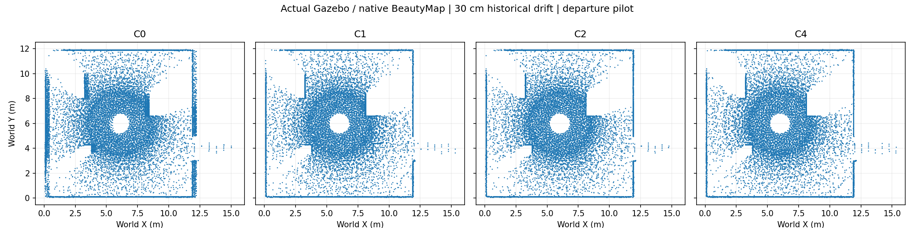

# Measured departure pilot

Not a paper benchmark or an H1 success claim.

| Drift cm | Group | SA % | DA % | HA % | Observed coverage % | Surface precision % |
|---:|---|---:|---:|---:|---:|---:|
| 0 | C0 | 99.5684 | 68.3681 | 81.0700 | 99.5425 | 99.7145 |
| 0 | C1 | 99.9920 | 11.6009 | 20.7898 | 100.0000 | 99.2307 |
| 0 | C2 | 99.5684 | 68.3681 | 81.0700 | 99.5425 | 99.7145 |
| 0 | C4 | 99.5684 | 68.3681 | 81.0700 | 99.5425 | 99.7145 |
| 10 | C0 | 99.5262 | 68.3681 | 81.0560 | 97.5264 | 93.2632 |
| 10 | C1 | 100.0000 | 11.6009 | 20.7900 | 100.0000 | 99.2308 |
| 10 | C2 | 99.5262 | 68.3681 | 81.0560 | 99.5340 | 99.7144 |
| 10 | C4 | 99.5684 | 68.3681 | 81.0700 | 99.5425 | 99.7145 |
| 30 | C0 | 99.0170 | 77.4942 | 86.9434 | 95.8133 | 90.7357 |
| 30 | C1 | 99.9331 | 19.8763 | 33.1576 | 99.9976 | 99.3007 |
| 30 | C2 | 99.0170 | 77.4942 | 86.9434 | 99.4048 | 99.7921 |
| 30 | C4 | 99.5684 | 68.3681 | 81.0700 | 99.5425 | 99.7145 |

C1 uses fixed old-coordinate multi-frame protection. C2 freezes native keep/delete decisions.
C4 is a full native rerun on the corrected historical prefix. Future observations used: 0.
Coverage reference uses the same sensor samples with simulator poses; primitive distances use independent SDF box geometry.
SDF labels are evaluation only; native input has XYZ and sensor viewpoint only. Ambiguous/unknown labels are excluded from SA/DA.
When the dynamic denominator is zero, DA and HA are undefined.

