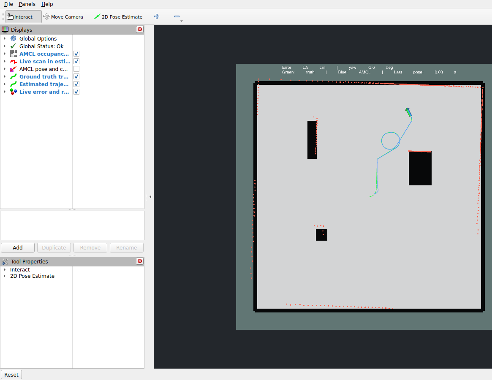

# AMCL 本机接入验证，2026-10-14

本记录是工程接入试跑，不是论文排名或统计结论。实际执行轮式物理仿真、标准 ROS 键盘节点、AMCL、真值同步和 ROS bag。Windows PowerShell 5.1 的启动/退出已验证，Windows Terminal 独立键盘窗口已确认有原生节点。关键帧导出具有 40 RGB / 40 depth / 40 poses 的完整配对。

[键盘驾驶误差](keyboard-summary.json)与[轨迹图](keyboard-trajectory.png)来自一次约 106 秒会话，含初始静止等待，不能当作固定路线算法精度。截图是实际当前真值/估计，未手工画偏移。

[地图构建记录](maps.json)：独立建图录制 `amcl-live-20261014-025624-a4835b`，16 个 LiDAR 输入、4 个 RGB-D 输入；四个原生方法都完成，加入两类原始地图基线，共六张地图。地图 PGM/YAML 和投影来源保存在 [maps/](maps/)。未上传 RGB-D、原始扫描、权重或 ROS bag。

[同输入回放 CSV](comparison.csv)与[详细记录](comparison.json)：另一录制 `amcl-live-20261014-025523-bbb0f8`，每张地图均有 80 个同时间真值匹配的 AMCL 更新，实时因子中位数约 1。每组 AMCL 新启动，恢复同一里程计尺度，排除原定位输出和 TF 回放。

这只是一轮短路线配对验证。随机采样、初始化收敛、投影和覆盖范围均会影响误差，暂不依据一轮数字判优。LiDAR 与 RGB-D 家族分别比较；CG/HOV 的语义特征没有被 AMCL 消费。记录的观测延迟不是内部算法耗时，离线模型推理也不包含在回放延迟中。
