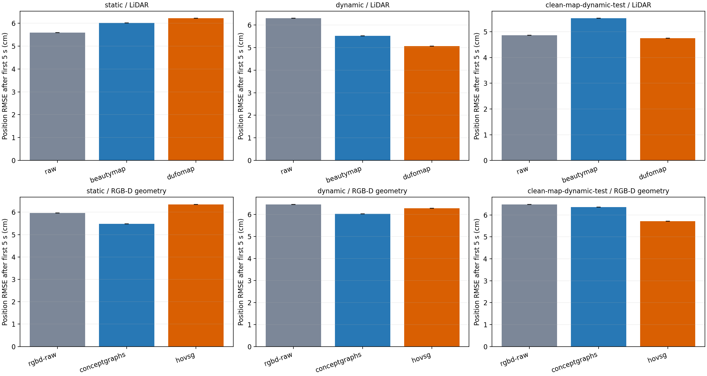
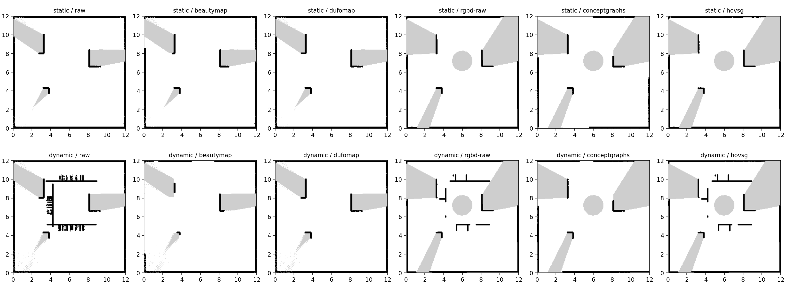

# 静态与动态场景定位实测

使用真实 Gazebo 传感器录制，地图来自作者算法的实际执行。每种场景分别采集建图 A 与测试 B；各方法回放相同 B。机器人由轮关节运动，障碍物由目标 10 Hz 的脚本轨迹驱动。

主实验建图 A 明确使用仿真提供的传感器位姿，隔离轮速漂移和动态过滤影响；它不是建图位姿估计算法或完整 SLAM 的评测。测试 B 的 AMCL 仅使用激光、轮速和待测地图，真值只用于评分/显示。较早的纯轮速建图结果保存在诊断目录，没有与给定位姿版本混在同一统计中。

主指标为去掉前 5 秒初始化后的位置 RMSE。重复运行检查同一输入下的可复现性和实际波动，不代表独立场景/路线样本。若输出一致，标准差照实为 0，这不表示泛化不确定性为 0。正的‘减少’表示相对本家族原始地图误差下降，负值表示上升。

| 条件 | 地图 | 次数 | 初始化后 RMSE 均值 ± 标准差（cm） | 相对本家族基线减少（cm） |
|---|---|---:|---:|---:|
| static | raw | 3 | 5.59 ± 0.00 | +0.00 |
| static | beautymap | 3 | 6.01 ± 0.00 | -0.42 |
| static | dufomap | 3 | 6.21 ± 0.00 | -0.62 |
| static | rgbd-raw | 3 | 5.97 ± 0.00 | +0.00 |
| static | conceptgraphs | 3 | 5.48 ± 0.00 | +0.48 |
| static | hovsg | 3 | 6.35 ± 0.00 | -0.39 |
| dynamic | raw | 3 | 6.29 ± 0.00 | +0.00 |
| dynamic | beautymap | 3 | 5.52 ± 0.00 | +0.78 |
| dynamic | dufomap | 3 | 5.06 ± 0.00 | +1.23 |
| dynamic | rgbd-raw | 3 | 6.45 ± 0.00 | +0.00 |
| dynamic | conceptgraphs | 3 | 6.02 ± 0.00 | +0.43 |
| dynamic | hovsg | 3 | 6.28 ± 0.00 | +0.18 |
| clean-map-dynamic-test | raw | 1 | 4.86（单次） | +0.00 |
| clean-map-dynamic-test | beautymap | 1 | 5.52（单次） | -0.66 |
| clean-map-dynamic-test | dufomap | 1 | 4.75（单次） | +0.11 |
| clean-map-dynamic-test | rgbd-raw | 1 | 6.48（单次） | +0.00 |
| clean-map-dynamic-test | conceptgraphs | 1 | 6.36（单次） | +0.12 |
| clean-map-dynamic-test | hovsg | 1 | 5.71（单次） | +0.77 |

static：静态建图 + 静态测试。dynamic：动态建图 + 动态测试。clean-map-dynamic-test：静态干净地图 + 与 dynamic 完全相同的动态测试 B，用于分辨地图残影与实时动态遮挡。

LiDAR 家族基线为 raw；RGB-D 家族基线为 rgbd-raw。CG/HOV-SG 只提供几何投影，AMCL 没有使用 CLIP 语义或层级关系。在线推理耗时不包含在回放中。

Measured tables: [summary.csv](summary.csv), [summary.json](summary.json), comparison-static.csv, comparison-dynamic.csv and comparison-clean-map-dynamic-test.csv.

[Recorded-data reconstruction video](dynamic-localization-replay.mp4). [Four-category GIF/MP4 gallery with frozen live traces and timing checks](https://github.com/p20030920p/SLAM_Learning/tree/main/results/localization/static-dynamic). Raw bags, scans, RGB-D, native artifacts and full per-repeat traces remain in the local runs folder. Original benchmark: static-dynamic-20261014-033854-8e3b79.

