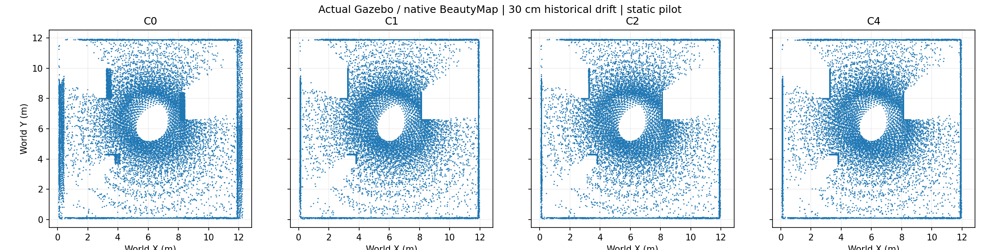

# Measured static pilot

Not a paper benchmark or an H1 success claim.

| Drift cm | Group | SA % | DA % | HA % | Observed coverage % | Surface precision % |
|---:|---|---:|---:|---:|---:|---:|
| 0 | C0 | 99.8299 | undefined | undefined | 99.7697 | 99.9819 |
| 0 | C1 | 99.9127 | undefined | undefined | 99.9326 | 99.9819 |
| 0 | C2 | 99.8299 | undefined | undefined | 99.7697 | 99.9819 |
| 0 | C4 | 99.8299 | undefined | undefined | 99.7697 | 99.9819 |
| 10 | C0 | 99.8319 | undefined | undefined | 96.4211 | 92.5854 |
| 10 | C1 | 99.9146 | undefined | undefined | 99.9326 | 99.9819 |
| 10 | C2 | 99.8319 | undefined | undefined | 99.7697 | 99.9819 |
| 10 | C4 | 99.8299 | undefined | undefined | 99.7697 | 99.9819 |
| 30 | C0 | 99.7594 | undefined | undefined | 93.8322 | 89.4380 |
| 30 | C1 | 99.9256 | undefined | undefined | 99.9338 | 99.9819 |
| 30 | C2 | 99.7594 | undefined | undefined | 99.7697 | 99.9818 |
| 30 | C4 | 99.8299 | undefined | undefined | 99.7697 | 99.9819 |

C1 uses fixed old-coordinate multi-frame protection. C2 freezes native keep/delete decisions.
C4 is a full native rerun on the corrected historical prefix. Future observations used: 0.
Coverage reference uses the same sensor samples with simulator poses; primitive distances use independent SDF box geometry.
SDF labels are evaluation only; native input has XYZ and sensor viewpoint only. Ambiguous/unknown labels are excluded from SA/DA.
When the dynamic denominator is zero, DA and HA are undefined.

